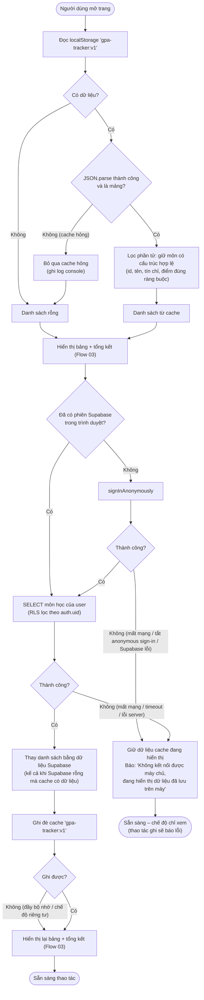

# Flow 01 – Khởi động trang và tải dữ liệu (F5)

## Edge cases

| Tình huống | Xử lý |
|------------|-------|
| Lần đầu mở, chưa có cache | Danh sách rỗng, hiển thị "—" và "Hãy thêm môn học đầu tiên". |
| Cache không phải JSON / không phải mảng | Bỏ qua, danh sách rỗng, trang vẫn hoạt động bình thường. |
| Cache có vài phần tử sai cấu trúc (thiếu trường, điểm > 10, tín chỉ không nguyên…) | Bỏ phần tử đó, giữ phần còn lại. |
| `localStorage` bị chặn (truy cập ném lỗi) | Coi như không có cache; vẫn tải từ Supabase. |
| Anonymous sign-in bị tắt hoặc lỗi | Chế độ chỉ xem với dữ liệu cache + thông báo lỗi. |
| Phiên hết hạn / token không hợp lệ | Supabase client tự làm mới; nếu thất bại → đăng nhập ẩn danh lại (user mới, danh sách Supabase rỗng). |
| Supabase rỗng nhưng cache có dữ liệu | Supabase là chuẩn → danh sách rỗng, cache bị ghi đè. |
| Mất mạng khi đang tải | Giữ dữ liệu cache đã hiển thị, báo lỗi; không làm trắng trang. |
