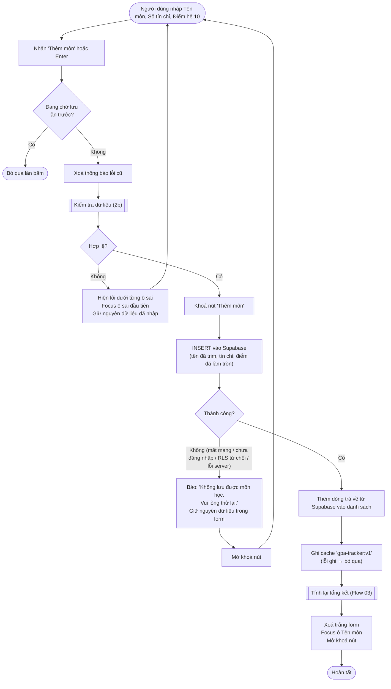
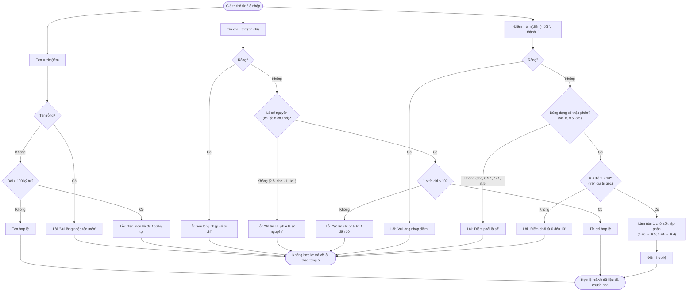

# Flow 02 – Thêm môn học (F1, F5)

## 2a. Luồng thêm môn

## 2b. Sub-flow kiểm tra dữ liệu (dùng chung cho Thêm và Sửa)

## Edge cases

| Tình huống | Xử lý |
|------------|-------|
| Tên chỉ toàn khoảng trắng | Lỗi "Vui lòng nhập tên môn". |
| Tên đúng 100 ký tự sau trim / 101 ký tự | Hợp lệ / lỗi. |
| Tín chỉ `0`, `11`, `2.5`, `-1` | Lỗi tương ứng. |
| Điểm `8,5` và `8.5` | Cả hai → 8.5. |
| Điểm `8.45` / `8.44` | Làm tròn → 8.5 / 8.4 (dùng làm tròn thập phân chính xác, tránh sai số float). |
| Điểm `10.04` / `10.05` / `-0.01` | 10.0 hợp lệ / lỗi / lỗi. |
| Nhiều ô sai cùng lúc | Hiện lỗi dưới tất cả các ô sai, focus ô sai đầu tiên. |
| Bấm Enter / nút nhiều lần liên tiếp | Chỉ gửi một lần (nút bị khoá khi đang lưu). |
| Trùng tên với môn đã có | Cho phép. |
| Supabase lỗi / offline | Báo lỗi tiếng Việt, form giữ nguyên dữ liệu, danh sách không đổi. |
