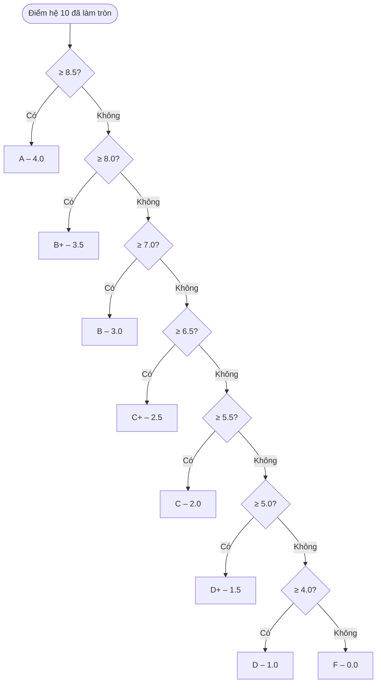
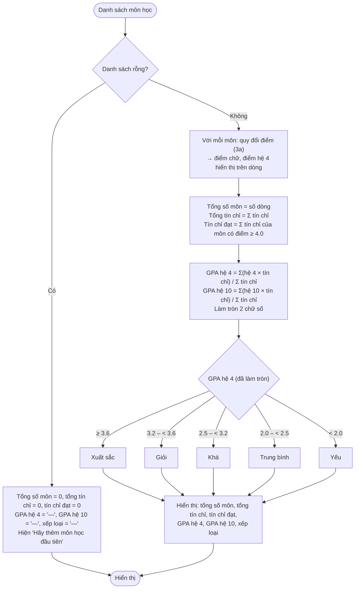

# Flow 03 – Quy đổi điểm, tính GPA và xếp loại (F2, F3)

Chạy mỗi khi danh sách môn thay đổi (tải trang, thêm, sửa, xoá, xoá tất cả). Là hàm thuần, không gọi Supabase.

## 3a. Quy đổi một điểm hệ 10 (đã làm tròn 1 chữ số)

## 3b. Tính tổng kết và xếp loại

## Edge cases

| Tình huống | Xử lý |
|------------|-------|
| Danh sách rỗng | "—" cho GPA và xếp loại, dòng "Hãy thêm môn học đầu tiên". Không chia cho 0. |
| Điểm đúng biên: 8.5, 8.0, 7.0, 6.5, 5.5, 5.0, 4.0 | Thuộc bậc cao hơn (A, B+, B, C+, C, D+, D). |
| Điểm 3.9 / 4.0 | F (không tính tín chỉ đạt) / D (tính tín chỉ đạt). |
| Tất cả môn đều F | GPA = 0.00, xếp loại Yếu, tín chỉ đạt = 0. |
| GPA hệ 4 = 3.595 | Làm tròn 3.60 → Xuất sắc. |
| GPA hệ 4 = 4.0 | Xuất sắc. |
| Chỉ một môn | GPA = điểm của môn đó. |
