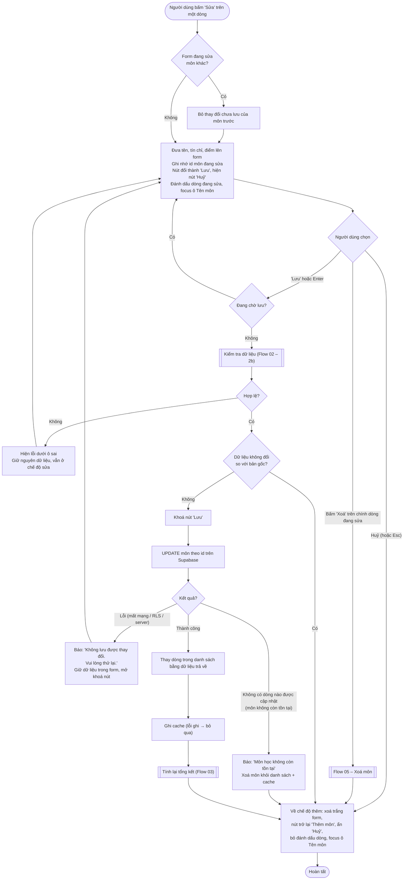

# Flow 04 – Sửa môn học (F4, F5)

## Edge cases

| Tình huống | Xử lý |
|------------|-------|
| Bấm "Sửa" dòng B khi đang sửa dòng A | Bỏ thay đổi chưa lưu của A, nạp B. |
| Dữ liệu sửa không hợp lệ | Cùng thông báo lỗi như F1, vẫn ở chế độ sửa. |
| Bấm "Lưu" mà không thay đổi gì | Không gọi Supabase, về chế độ thêm. |
| Xoá chính dòng đang sửa | Sau khi xoá thành công, form về chế độ thêm. |
| Xoá dòng khác khi đang sửa | Không ảnh hưởng form đang sửa. |
| "Xoá tất cả" khi đang sửa | Sau khi xoá thành công, form về chế độ thêm (Flow 06). |
| Supabase lỗi / offline | Báo lỗi, giữ dữ liệu trong form, danh sách không đổi. |
| Môn đã bị xoá trên server (UPDATE trả 0 dòng) | Báo "Môn học không còn tồn tại", xoá khỏi danh sách. |
| Bấm "Lưu" nhiều lần | Chỉ gửi một lần. |
