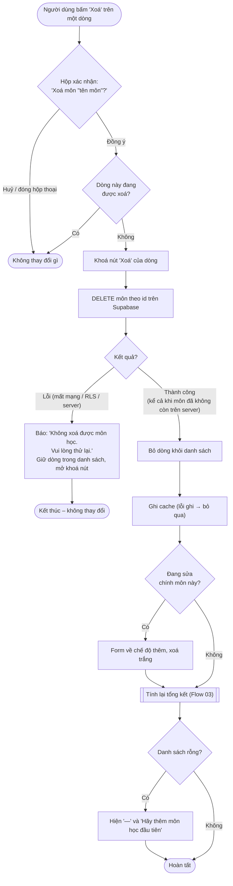

# Flow 05 – Xoá một môn học (F4, F5)

## Edge cases

| Tình huống | Xử lý |
|------------|-------|
| Người dùng bấm Huỷ trong hộp xác nhận | Không gọi Supabase, không thay đổi gì. |
| Xoá môn cuối cùng | Danh sách rỗng → trạng thái trống của Flow 03. |
| Xoá môn đang được sửa | Form về chế độ thêm. |
| Môn đã bị xoá trên server từ trước | Coi là thành công (DELETE idempotent), bỏ dòng khỏi danh sách. |
| Supabase lỗi / offline | Báo lỗi, dòng vẫn còn. |
| Bấm "Xoá" liên tục | Nút bị khoá khi đang xoá. |
