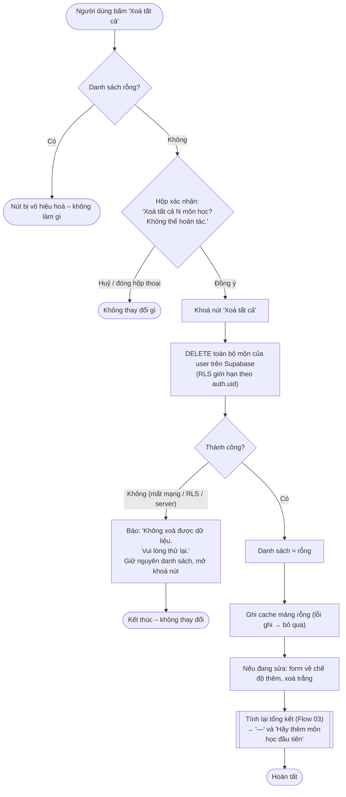

# Flow 06 – Xoá tất cả môn học (F5)

## Edge cases

| Tình huống | Xử lý |
|------------|-------|
| Danh sách rỗng | Nút "Xoá tất cả" bị vô hiệu hoá. |
| Người dùng bấm Huỷ | Không thay đổi gì. |
| Đang sửa một môn | Sau khi xoá, form về chế độ thêm. |
| Supabase lỗi / offline | Báo lỗi, danh sách và cache giữ nguyên (không xoá cache trước khi server xác nhận). |
| Chỉ xoá dữ liệu của chính user | Đảm bảo bởi RLS; câu lệnh vẫn lọc theo `user_id` để không phụ thuộc vào việc RLS có bật hay không. |
