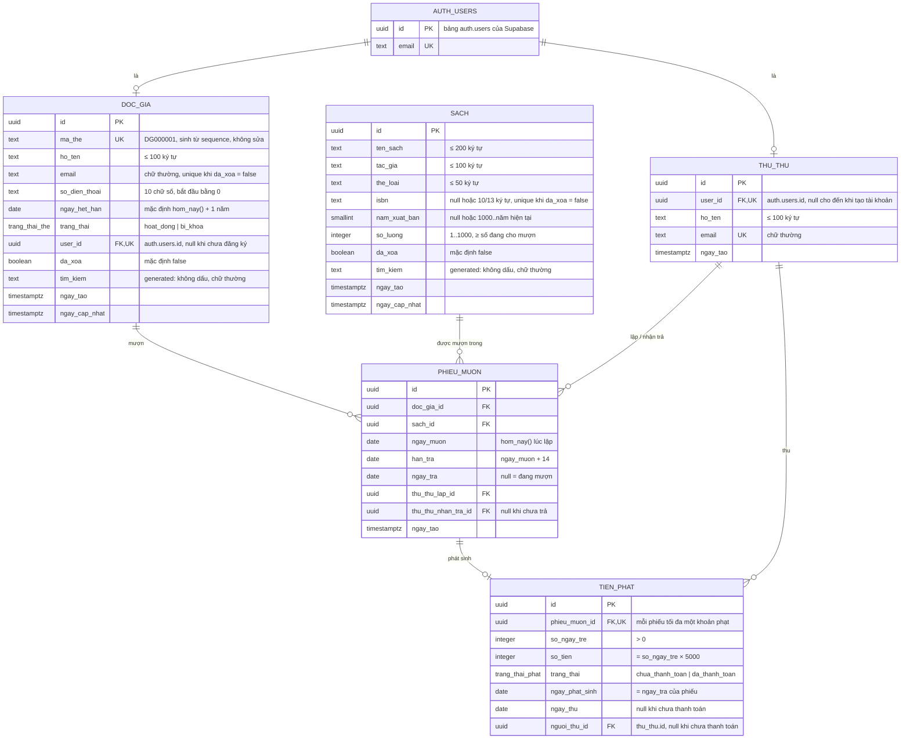

# ERD – Library Manager

Dựng từ `PRD.md` và các flow trong `design/flows/`. Tên bảng/cột tiếng Việt không dấu, `snake_case`, trùng với tên đã dùng trong flow (`da_xoa`, `han_tra`, `ngay_tra`, RPC `lap_phieu_muon`…).

## Sơ đồ

## Ràng buộc trong CSDL

| Bảng | Ràng buộc | Nguồn |
|------|-----------|-------|
| `doc_gia` | Unique index `lower(email)` `WHERE da_xoa = false` | F3, Flow 3 edge case |
| `doc_gia` | `ma_the` default `'DG' \|\| lpad(nextval('doc_gia_ma_the_seq')::text, 6, '0')`; trigger chặn sửa `ma_the` | F3 |
| `doc_gia` | CHECK `email = lower(btrim(email))`, `so_dien_thoai ~ '^0[0-9]{9}$'`, `char_length(ho_ten) BETWEEN 1 AND 100` | F3, Flow 3b |
| `doc_gia` | Trigger chặn đổi `email` khi `user_id IS NOT NULL` | F3 |
| `doc_gia` | Trigger chặn `ngay_het_han < hom_nay()` khi INSERT hoặc khi cột này thay đổi | Flow 3b |
| `sach` | Unique index `isbn` `WHERE da_xoa = false AND isbn IS NOT NULL` | F2, Flow 2 edge case |
| `sach` | CHECK `isbn ~ '^([0-9]{9}[0-9X]\|[0-9]{13})$'`, `so_luong BETWEEN 1 AND 1000`, `nam_xuat_ban >= 1000`, độ dài các cột text | F2, Flow 2b |
| `sach` | Trigger: `nam_xuat_ban <= năm của hom_nay()`; `so_luong >= số phiếu đang mượn`; không cho đặt `da_xoa = true` khi còn phiếu đang mượn. Trigger đọc số phiếu sau khi khoá dòng sách (`FOR UPDATE`) | F2, Flow 2a, 2c |
| `phieu_muon` | Unique index `(doc_gia_id, sach_id)` `WHERE ngay_tra IS NULL` — một độc giả không giữ hai cuốn cùng đầu sách | F4 điều kiện 5 |
| `phieu_muon` | CHECK `han_tra = ngay_muon + 14`, `ngay_tra IS NULL OR ngay_tra >= ngay_muon`, `(ngay_tra IS NULL) = (thu_thu_nhan_tra_id IS NULL)` | F4, F5 |
| `phieu_muon` | Index `(doc_gia_id) WHERE ngay_tra IS NULL`, `(sach_id) WHERE ngay_tra IS NULL`, `(han_tra) WHERE ngay_tra IS NULL` | F4, F6a |
| `tien_phat` | CHECK `so_ngay_tre > 0`, `so_tien = so_ngay_tre * 5000`, `(trang_thai = 'da_thanh_toan') = (ngay_thu IS NOT NULL) = (nguoi_thu_id IS NOT NULL)` | F5, F6 |
| `tien_phat` | Index `(trang_thai) WHERE trang_thai = 'chua_thanh_toan'` | F6b |
| Mọi FK | `ON DELETE RESTRICT` — không xoá cứng dòng nào, chỉ xoá mềm | README #4 |

`phieu_muon` và `tien_phat` không bao giờ bị xoá. Hai bảng này không có `da_xoa`.

## Dữ liệu tính toán (không lưu)

| Giá trị | Cách tính | Ở đâu |
|---------|-----------|-------|
| Hôm nay | `(now() AT TIME ZONE 'Asia/Ho_Chi_Minh')::date` | Hàm `hom_nay()` (`STABLE`) |
| Số đang cho mượn, số còn lại | `count(phieu_muon WHERE ngay_tra IS NULL)`; `so_luong − số đó` | View `v_sach`, đếm qua hàm `so_dang_muon(sach_id)` (`SECURITY DEFINER`) vì RLS chỉ cho độc giả thấy phiếu của mình |
| Thẻ hết hạn | `ngay_het_han < hom_nay()` | View `v_doc_gia` (cột `trang_thai_hien_thi`: `hoat_dong` / `bi_khoa` / `het_han`; cùng các cột `so_dang_muon`, `so_qua_han`) |
| Quá hạn, số ngày trễ, phạt dự kiến | `ngay_tra IS NULL AND han_tra < hom_nay()`; `hom_nay() − han_tra`; × 5000 | View `v_phieu_qua_han` |
| Tổng phạt chưa thanh toán của độc giả | `sum(so_tien) WHERE trang_thai = 'chua_thanh_toan'` | View `v_doc_gia` |

Các view tạo với `security_invoker = true` để RLS của bảng gốc vẫn áp dụng.

Tìm kiếm (Flow 2d, 3d, 7): cột generated `tim_kiem` = `f_unaccent(lower(...))` ghép các cột được tìm, có GIN index `pg_trgm`. Vì `unaccent()` không phải `IMMUTABLE`, cần bọc trong hàm `f_unaccent` khai báo `IMMUTABLE` dùng từ điển `public.unaccent`. Client cũng bỏ dấu và đổi chữ thường cho từ khoá rồi dùng `ILIKE`, có escape `%` và `_`.

## Hàm RPC (`SECURITY DEFINER`, kiểm tra `la_thu_thu()` ở đầu hàm)

| Hàm | Việc làm | Lỗi trả về (mã → thông báo ở client) |
|-----|----------|--------------------------------------|
| `lap_phieu_muon(doc_gia_id, sach_id)` | Khoá dòng `doc_gia` rồi `sach` (luôn theo thứ tự này để tránh deadlock); kiểm tra lại toàn bộ Flow 4b và gom mọi lý do; kiểm tra còn sách; INSERT phiếu với `hom_nay()` | Danh sách lý do; `HET_SACH`; `DOC_GIA_KHONG_TON_TAI`; `SACH_KHONG_TON_TAI` |
| `nhan_tra_sach(phieu_id)` | Khoá phiếu; nếu đã trả thì trả lỗi `DA_TRA` kèm `ngay_tra` (idempotent); ghi `ngay_tra = hom_nay()`; nếu trễ thì INSERT `tien_phat` | `DA_TRA` |
| `thu_tien_phat(phat_id)` | `UPDATE … WHERE trang_thai = 'chua_thanh_toan'`; 0 dòng → `DA_THU` | `DA_THU` |
| `xoa_doc_gia(doc_gia_id)` | Khoá độc giả; đếm phiếu đang mượn và tổng phạt chưa thu; nếu đều bằng 0 thì `da_xoa = true` | `CON_SACH` (kèm N); `CON_PHAT` (kèm X) |

Lỗi nghiệp vụ trả về qua `RAISE EXCEPTION`: `message` là mã lỗi, `detail` là JSON kèm số liệu (ví dụ `{"so_tien": 15000}`). `KHONG_DU_DIEU_KIEN` có `detail` là mảng lý do: `THE_BI_KHOA`, `THE_HET_HAN` (`ngay_het_han`), `CO_SACH_QUA_HAN` (`so_sach`), `CON_PHAT` (`so_tien`), `DA_MUON_TOI_DA` (`toi_da`), `DANG_MUON_DAU_SACH`. Người không phải thủ thư nhận `KHONG_CO_QUYEN` (SQLSTATE `42501`). Trigger trả các mã `DA_XOA`, `MA_THE_KHONG_SUA_DUOC`, `EMAIL_KHONG_SUA_DUOC`, `NGAY_HET_HAN_KHONG_HOP_LE`, `NAM_XUAT_BAN_KHONG_HOP_LE`, `CON_SACH_DANG_MUON`, `SO_LUONG_NHO_HON_DANG_MUON`, `EMAIL_CHUA_DANG_KY`. `nhan_tra_sach` trả về `{phieu_muon, tien_phat}`.

Ngoài RLS, quyền `GRANT` theo cột chỉ cho client ghi các cột nghiệp vụ: `doc_gia` không ghi được `ma_the`, `user_id`, `da_xoa` (xoá qua `xoa_doc_gia`); `sach` ghi được `da_xoa` (xoá mềm qua UPDATE, trigger kiểm tra). `anon` không có quyền gì trên schema `public`.

Các tham số nghiệp vụ (14 ngày, 5 cuốn, 5.000 đ) là hằng số trong các hàm trên và trong CHECK. PRD §1.4 ghi các giá trị này "cần duyệt", nên khi cần đổi chỉ sửa một migration. Bảng cấu hình chưa cần thiết.

## Liên kết tài khoản (Flow 1b, 1d)

Trigger `AFTER INSERT ON auth.users` (`SECURITY DEFINER`):

1. Có dòng `thu_thu` với cùng email và `user_id IS NULL` → gán `user_id`.
2. Nếu không, có dòng `doc_gia` với cùng email, `da_xoa = false`, `user_id IS NULL` → gán `user_id`.
3. Nếu không có cả hai → `RAISE EXCEPTION`, Supabase huỷ việc tạo user. Client hiển thị "Email chưa được đăng ký tại thư viện".

Cách tạo tài khoản thủ thư: chạy SQL thêm dòng `thu_thu` (họ tên, email), rồi tạo user trong Supabase Dashboard với đúng email đó.

Hàm `la_thu_thu()` (`STABLE SECURITY DEFINER`): `EXISTS (SELECT 1 FROM thu_thu WHERE user_id = auth.uid())`. Hàm `doc_gia_hien_tai()` trả về `doc_gia.id` của `auth.uid()` khi `da_xoa = false`.

## RLS

| Bảng | Thủ thư | Độc giả |
|------|---------|---------|
| `thu_thu` | SELECT | — |
| `doc_gia` | SELECT, INSERT, UPDATE (xoá qua RPC) | SELECT dòng của mình |
| `sach` | SELECT, INSERT, UPDATE | SELECT dòng `da_xoa = false`, cộng các sách có trong phiếu của mình (Flow 7 edge case) |
| `phieu_muon` | SELECT (ghi qua RPC) | SELECT phiếu của mình |
| `tien_phat` | SELECT (ghi qua RPC) | SELECT khoản phạt gắn với phiếu của mình |

Không có policy DELETE trên bất kỳ bảng nào. Không có policy INSERT/UPDATE trên `phieu_muon` và `tien_phat`, nên chỉ RPC ghi được vào hai bảng này.

## Quyết định thiết kế cần duyệt

1. **Số còn lại tính bằng view** (`v_sach`), không lưu cột đếm. Không bao giờ lệch dữ liệu. Đổi lại, mỗi lần đọc phải đếm phiếu, nhưng chi phí nhỏ vì đã có index partial và mỗi trang chỉ 20 dòng.
2. **`tien_phat` không có `doc_gia_id`.** Độc giả lấy qua `phieu_muon`, tránh lưu trùng dữ liệu. RLS và view phải join thêm một bảng.
3. **Mỗi phiếu có tối đa một khoản phạt** (unique `phieu_muon_id`). Không có chức năng gia hạn hay trả một phần nên không cần nhiều khoản cho một phiếu.
4. **Ghi lại thủ thư thao tác** (`thu_thu_lap_id`, `thu_thu_nhan_tra_id`, `nguoi_thu_id`). PRD không yêu cầu, nhưng Flow 6b đã có `nguoi_thu`. Các cột này rẻ và giúp tra cứu khi có tranh chấp.
5. **Có khoảng hở khi tạo tài khoản thủ thư:** từ lúc thêm dòng `thu_thu` đến lúc tạo user, ai biết email đó có thể đăng ký trước qua form độc giả và nhận quyền thủ thư. Giảm rủi ro bằng cách làm hai bước liền nhau và bật xác nhận email trong Supabase Auth.
6. **Email của độc giả đã xoá mềm được dùng lại cho hồ sơ mới.** Nếu độc giả cũ đã có tài khoản thì email vẫn nằm trong `auth.users`, nên hồ sơ mới không đăng ký được. Hướng xử lý: `xoa_doc_gia` xoá luôn user trong `auth.users`, hoặc ghi chú rằng trường hợp này cần quản trị viên xử lý tay. Đề xuất cách thứ nhất.
7. **Khoá chính dùng `uuid`** (`gen_random_uuid()`), để client không đoán được id. Mã thẻ `DG000001` là cột hiển thị riêng.
