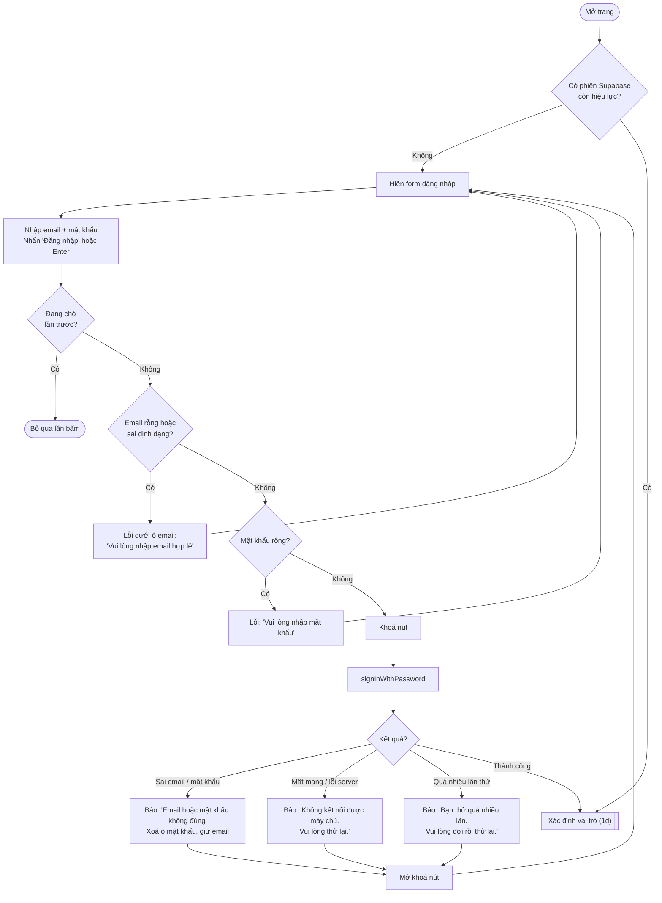
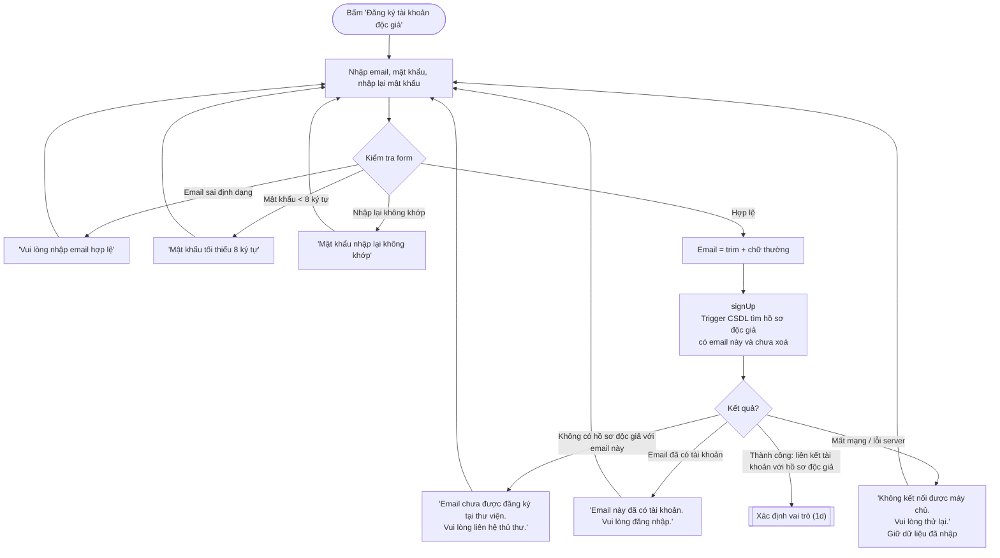
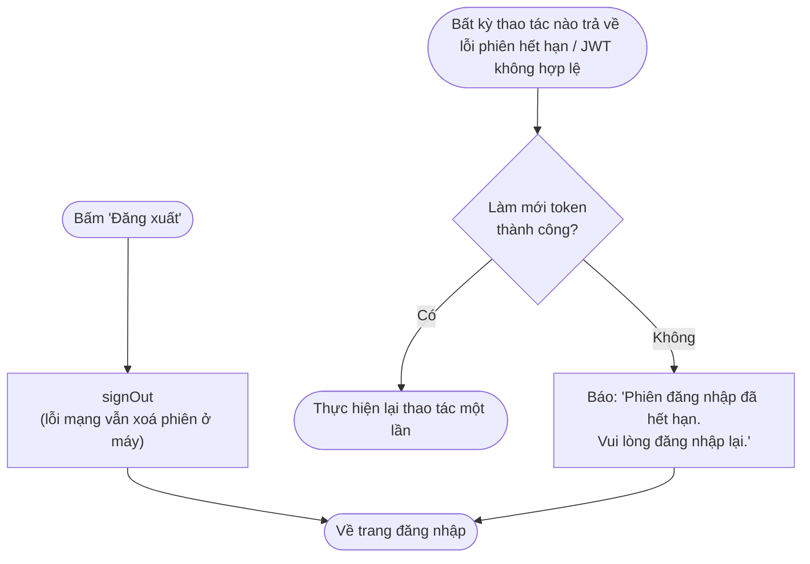
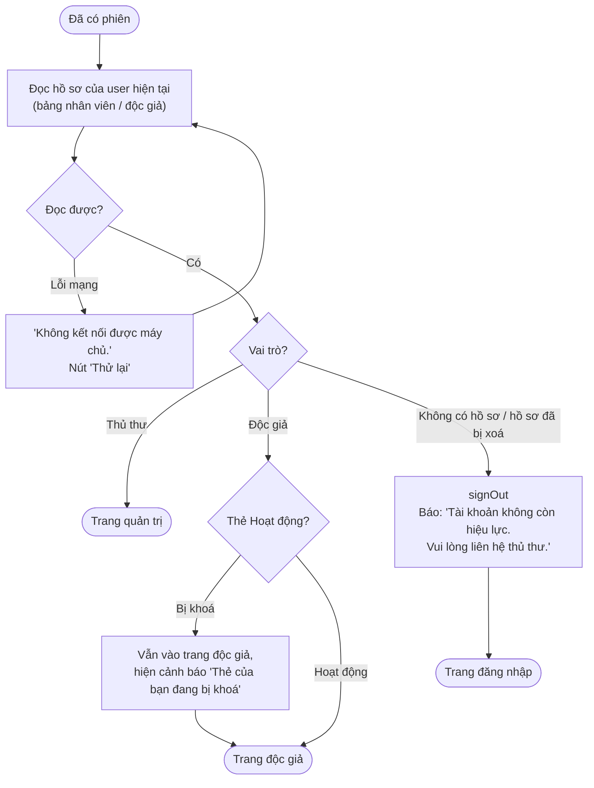

# Flow 01 – Đăng nhập và phân quyền (F1)

## 1a. Mở trang và đăng nhập

## 1b. Độc giả đăng ký tài khoản

## 1c. Đăng xuất và hết phiên

## 1d. Sub-flow xác định vai trò

## Edge cases

| Tình huống | Xử lý |
|------------|-------|
| Email có khoảng trắng / chữ hoa | Trim và đổi chữ thường trước khi gửi. |
| Sai mật khẩu | Thông báo chung "Email hoặc mật khẩu không đúng" (không tiết lộ email có tồn tại hay không). |
| Đăng ký bằng email không có trong hồ sơ độc giả | Từ chối, hướng dẫn liên hệ thủ thư. |
| Đăng ký email đã có tài khoản | Từ chối, gợi ý đăng nhập. |
| Thủ thư cố đăng ký qua form độc giả | Email thủ thư không có trong bảng độc giả → bị từ chối. |
| Độc giả bị xoá (mềm) khi đang đăng nhập | Lần đọc hồ sơ tiếp theo → đăng xuất, báo tài khoản không còn hiệu lực. |
| Độc giả bị khoá thẻ | Vẫn đăng nhập xem được thông tin của mình; chỉ không được mượn sách (Flow 04). |
| Độc giả gõ URL trang quản trị | Router kiểm tra vai trò → chuyển về trang độc giả; RLS chặn mọi truy vấn quản trị dù client bị sửa. |
| Phiên hết hạn giữa chừng khi đang nhập form | Thử làm mới token; nếu thất bại thì về trang đăng nhập (dữ liệu form chưa lưu sẽ mất — báo rõ trong thông báo). |
| Mở nhiều tab, đăng xuất ở một tab | Các tab khác nhận sự kiện `SIGNED_OUT` từ `onAuthStateChange` → về trang đăng nhập. |
