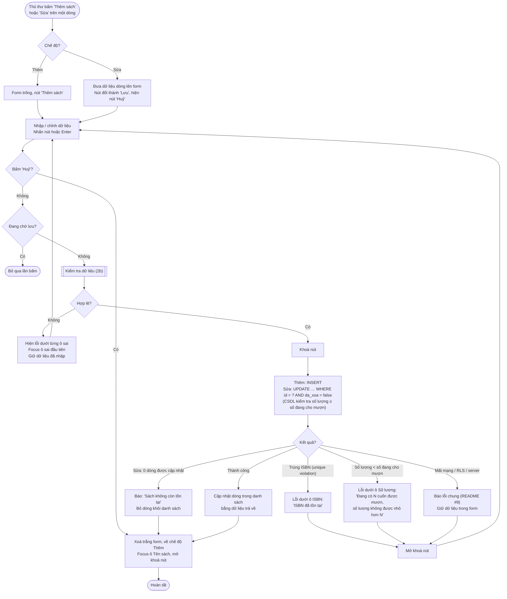
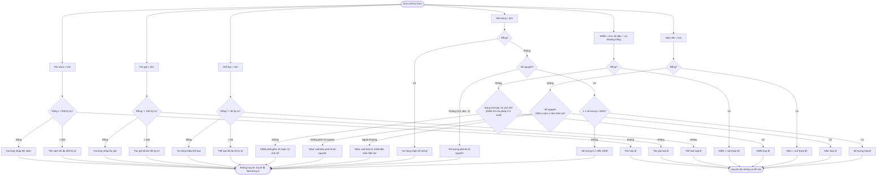
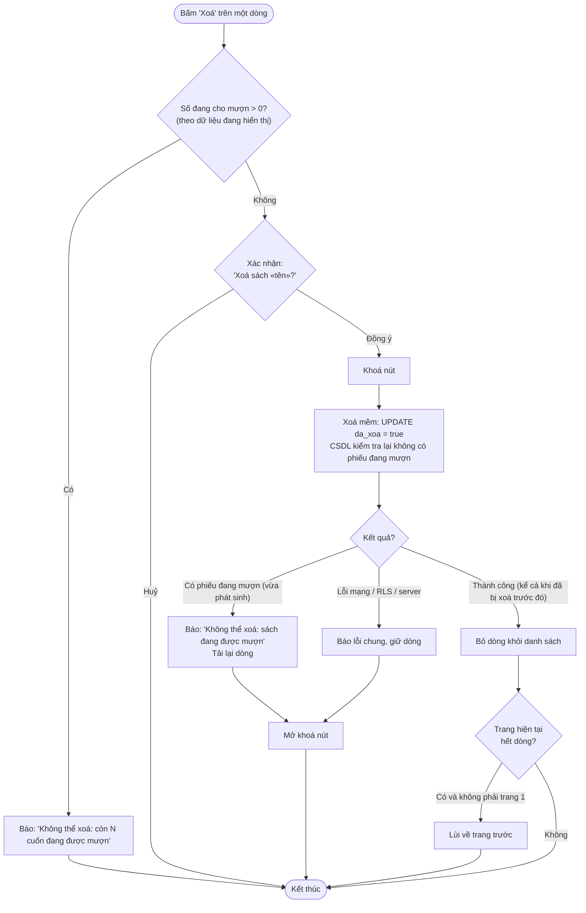
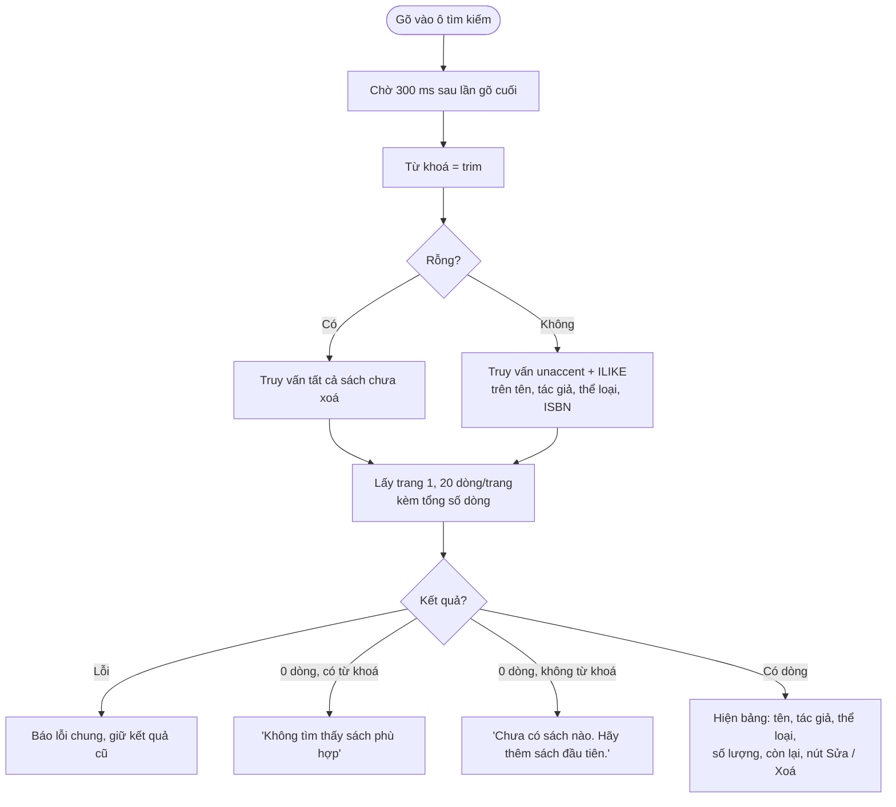

# Flow 02 – Quản lý sách (F2)

## 2a. Thêm / sửa sách

## 2b. Sub-flow kiểm tra dữ liệu sách (dùng chung cho Thêm và Sửa)

## 2c. Xoá sách

## 2d. Tìm kiếm và phân trang

## Edge cases

| Tình huống | Xử lý |
|------------|-------|
| ISBN `978-604-1-23456-7` | Bỏ dấu `-` → 13 chữ số, hợp lệ. |
| ISBN trùng sách đã xoá mềm | Cho phép (ràng buộc unique chỉ áp dụng cho sách chưa xoá). |
| Năm XB = năm sau | Lỗi. |
| Giảm số lượng xuống dưới số đang cho mượn | Lỗi dưới ô Số lượng, nêu số cuốn đang mượn. |
| Hai thủ thư cùng sửa một sách | Lần lưu sau ghi đè lần trước (chấp nhận, last-write-wins). |
| Sửa sách mà người khác vừa xoá | UPDATE trả 0 dòng → báo "Sách không còn tồn tại". |
| Xoá sách đang có người mượn | Bị chặn ở client và kiểm tra lại ở CSDL. |
| Tìm "nguyen du" | Khớp "Nguyễn Du" (không dấu, không phân biệt hoa thường). |
| Từ khoá chứa `%` hoặc `_` | Escape trước khi đưa vào ILIKE. |
| Gõ nhanh liên tục | Debounce; chỉ hiện kết quả của truy vấn mới nhất (bỏ kết quả về muộn). |
