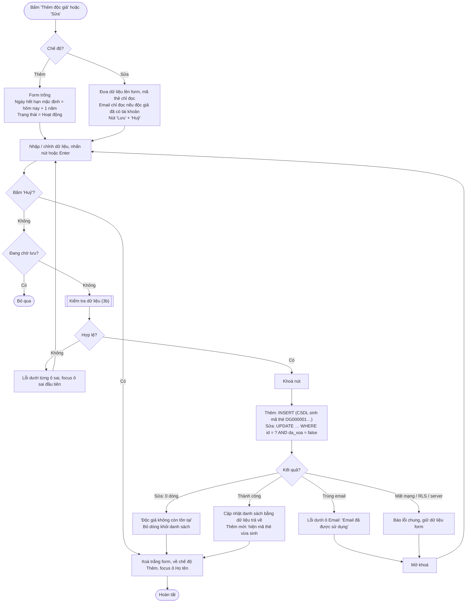
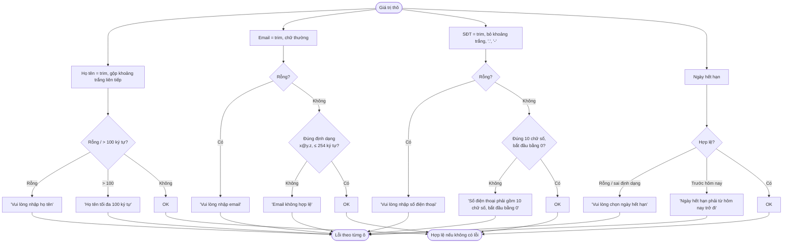
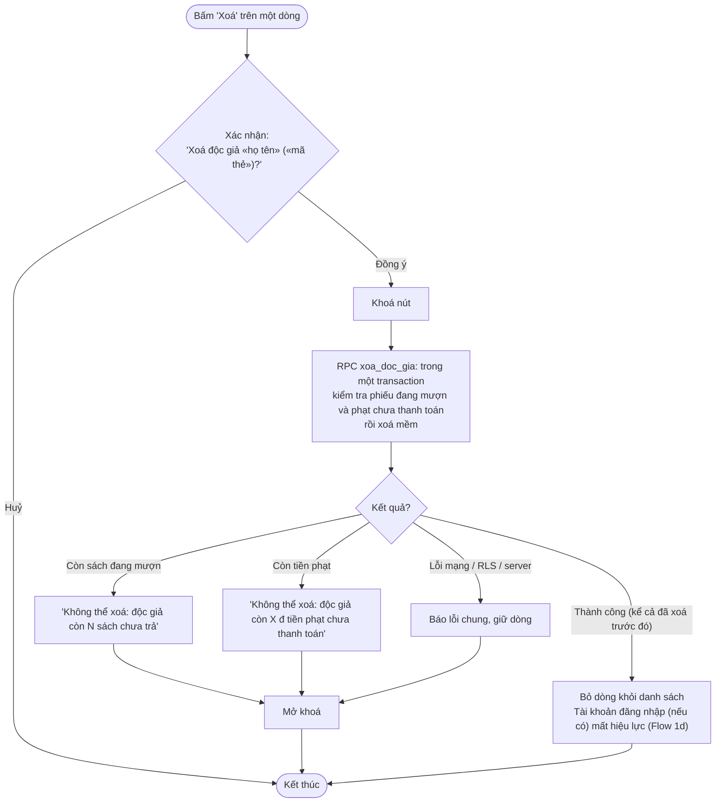

# Flow 03 – Quản lý độc giả (F3)

## 3a. Thêm / sửa độc giả

## 3b. Sub-flow kiểm tra dữ liệu độc giả

## 3c. Xoá độc giả

## 3d. Tìm kiếm

Giống Flow 2d, tìm trên mã thẻ, họ tên, email, số điện thoại. Mỗi dòng hiển thị trạng thái thẻ:
**Hoạt động**, **Bị khoá**, hoặc **Hết hạn** (tính động khi `ngay_het_han < hôm nay`).
Không có kết quả → "Không tìm thấy độc giả phù hợp"; chưa có ai → "Chưa có độc giả nào".

## Edge cases

| Tình huống | Xử lý |
|------------|-------|
| Email `An@Gmail.COM ` | Lưu `an@gmail.com`; trùng không phân biệt hoa thường. |
| Email trùng độc giả đã xoá mềm | Cho phép (unique chỉ áp dụng cho độc giả chưa xoá). |
| SĐT `090 123 4567` / `+84901234567` | Hợp lệ (bỏ khoảng trắng) / lỗi (PRD yêu cầu bắt đầu bằng 0). |
| Đổi email khi độc giả đã có tài khoản | Ô email bị khoá; CSDL cũng từ chối để email hồ sơ luôn khớp tài khoản. |
| Khoá thẻ độc giả đang mượn sách | Cho phép; độc giả không mượn thêm được, vẫn trả sách bình thường. |
| Gia hạn thẻ đã hết hạn | Sửa ngày hết hạn sang ngày ≥ hôm nay → trạng thái hiển thị về Hoạt động. |
| Hai thủ thư cùng thêm độc giả | Mã thẻ sinh từ sequence trong CSDL nên không trùng. |
| Xoá độc giả có phạt đã thanh toán, không còn sách mượn | Cho phép; lịch sử vẫn giữ. |
