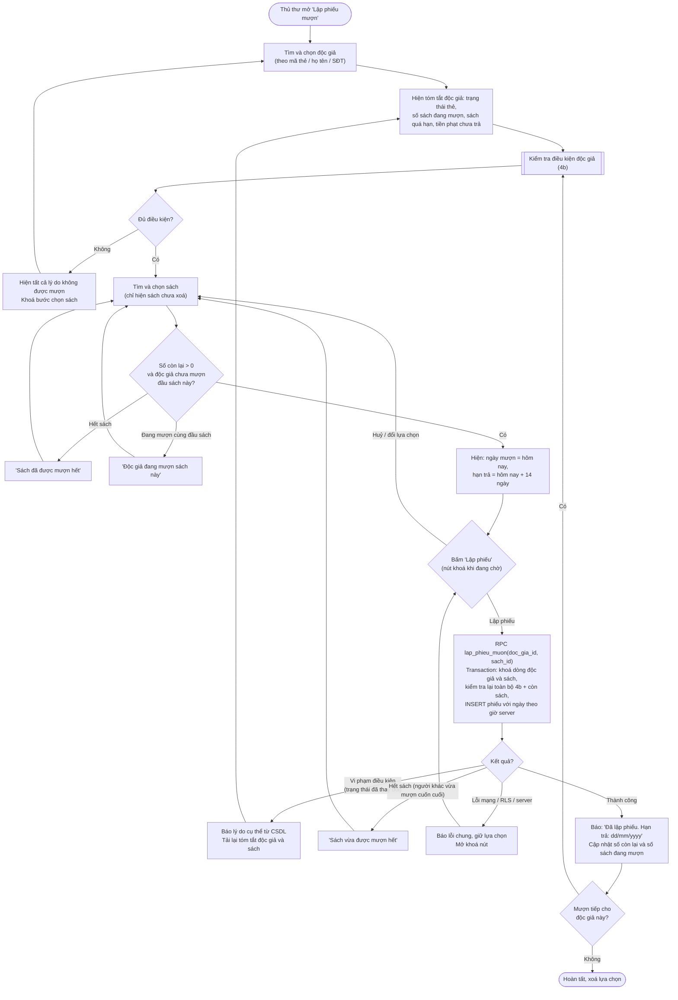
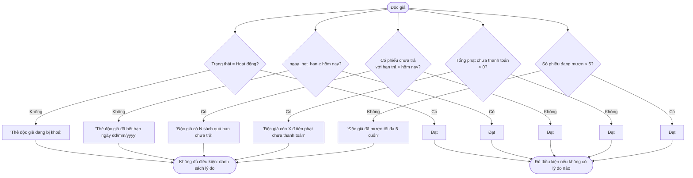

# Flow 04 – Mượn sách (F4)

## 4a. Lập phiếu mượn

## 4b. Sub-flow kiểm tra điều kiện độc giả

Chạy ở client để báo lỗi sớm và chạy lại trong RPC `lap_phieu_muon`. Thu thập **tất cả** lý do, không dừng ở lý do đầu tiên.

## Edge cases

| Tình huống | Xử lý |
|------------|-------|
| Hai thủ thư cùng cho mượn cuốn cuối cùng | RPC khoá dòng sách (`FOR UPDATE`); người sau nhận "Sách vừa được mượn hết". |
| Hai thủ thư cùng cho một độc giả mượn, đang có 4 cuốn | RPC khoá dòng độc giả; người sau nhận "đã mượn tối đa 5 cuốn". |
| Độc giả có sách quá hạn nhưng chưa trả → chưa có khoản phạt | Vẫn bị chặn bởi điều kiện 3 (quá hạn), không cần chờ phát sinh phạt. |
| Thẻ hết hạn đúng hôm nay (`ngay_het_han = hôm nay`) | Vẫn mượn được. |
| Hạn trả vượt quá ngày hết hạn thẻ | Cho phép (PRD không cấm) — ghi chú để duyệt. |
| Độc giả bị xoá / sách bị xoá trong lúc đang chọn | RPC báo "Độc giả không còn tồn tại" / "Sách không còn tồn tại". |
| Đồng hồ máy thủ thư sai ngày | Ngày mượn và hạn trả lấy từ server; ngày hiển thị ở bước xem trước chỉ mang tính tham khảo và được thay bằng giá trị server trả về. |
| Bấm 'Lập phiếu' hai lần | Nút bị khoá khi đang chờ; dù vậy RPC vẫn chặn trùng đầu sách. |
