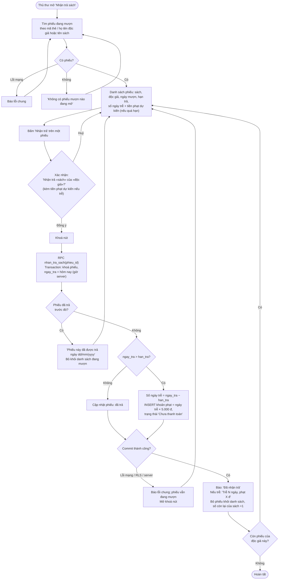

# Flow 05 – Trả sách (F5)

## Edge cases

| Tình huống | Xử lý |
|------------|-------|
| Trả đúng ngày hạn trả | Không trễ, không phạt. |
| Trả sau hạn 1 ngày | Phạt 5.000 đ. |
| Hai thủ thư cùng nhận trả một phiếu | RPC khoá phiếu; người sau nhận "Phiếu này đã được trả". |
| Mất mạng sau khi server đã commit nhưng client chưa nhận phản hồi | Client báo lỗi; khi thử lại, RPC trả "đã được trả" (idempotent) → không tạo phạt lần hai. |
| Sách đã bị xoá mềm | Vẫn nhận trả bình thường (phiếu tham chiếu sách đã xoá). — Thực tế không xảy ra vì không xoá được sách đang mượn. |
| Độc giả bị khoá thẻ / thẻ hết hạn | Vẫn nhận trả bình thường. |
| Tiền phạt rất lớn (trễ nhiều tháng) | Không giới hạn trần (PRD không nêu) — ghi chú để duyệt. |
| Trả nhầm phiếu | Ngoài phạm vi: không có chức năng huỷ trả; hộp xác nhận nêu rõ tên sách và độc giả để giảm nhầm lẫn. |
