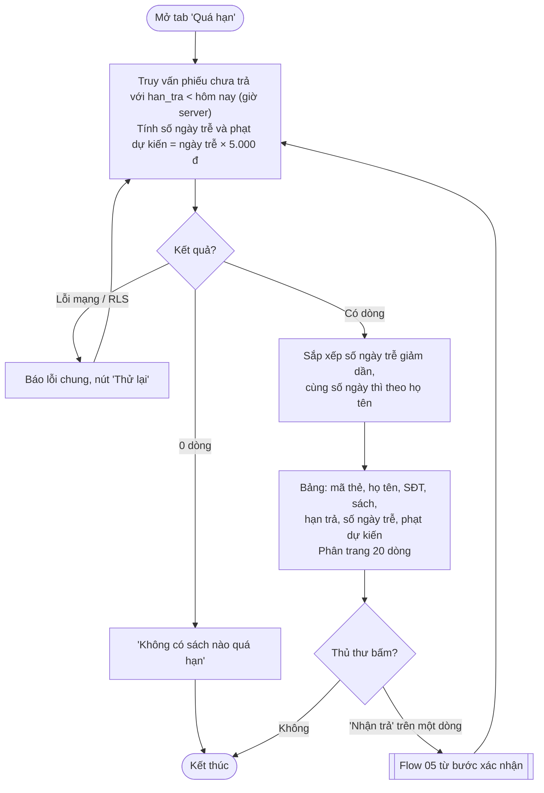
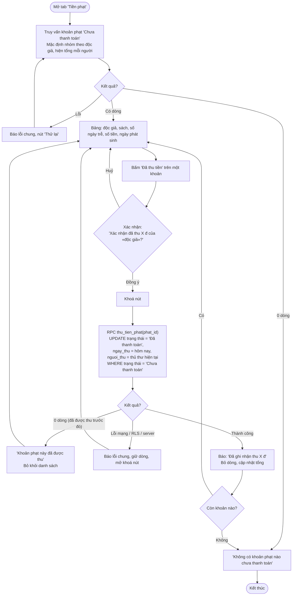

# Flow 06 – Quá hạn và tiền phạt (F6)

## 6a. Danh sách phiếu quá hạn

## 6b. Thu tiền phạt

## Edge cases

| Tình huống | Xử lý |
|------------|-------|
| Phiếu hết hạn hôm nay (`han_tra = hôm nay`) | Chưa tính là quá hạn. |
| Mở trang qua nửa đêm | Số ngày trễ tính lại khi tải lại danh sách; không tự cập nhật theo thời gian thực. |
| Phạt dự kiến (6a) khác phạt thực tế | Phạt thực tế chỉ được tạo khi nhận trả (Flow 05), dựa trên ngày trả thật. |
| Hai thủ thư cùng bấm "Đã thu tiền" | Điều kiện `WHERE trạng thái = 'Chưa thanh toán'` → người sau nhận "đã được thu". |
| Thu một phần tiền phạt | Ngoài phạm vi: chỉ ghi nhận thu đủ một khoản. |
| Miễn / huỷ khoản phạt | Ngoài phạm vi (PRD không nêu) — ghi chú để duyệt. |
| Độc giả đã bị xoá mềm có phạt chưa thu | Không xảy ra: không xoá được độc giả còn phạt (Flow 3c). |
| Định dạng tiền | `5.000 đ` (dấu chấm phân cách hàng nghìn, `Intl.NumberFormat('vi-VN')`). |
