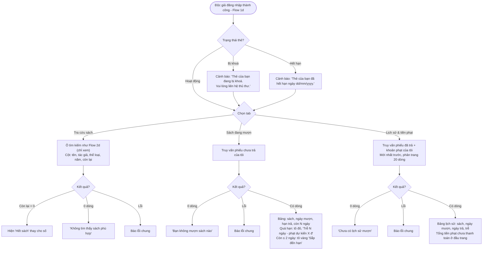

# Flow 07 – Trang độc giả (F7)

Mọi truy vấn chạy với quyền độc giả; RLS chỉ trả về danh mục sách (chưa xoá) và phiếu mượn, tiền phạt của chính độc giả đó.

## Edge cases

| Tình huống | Xử lý |
|------------|-------|
| Độc giả sửa request để đọc phiếu của người khác | RLS trả về 0 dòng. |
| Độc giả gọi INSERT/UPDATE bất kỳ bảng nào | RLS từ chối; giao diện độc giả không có nút ghi. |
| Sách đã bị xoá mềm nằm trong lịch sử | Vẫn hiện tên sách trong lịch sử (RLS cho đọc sách đã xoá nếu gắn với phiếu của chính độc giả). |
| Thẻ bị khoá / hết hạn | Vẫn xem được mọi tab, chỉ hiện cảnh báo. |
| Độc giả chưa từng mượn | Các tab hiện thông báo trống tương ứng. |
| Hạn trả hôm nay | Hiện "Hạn trả hôm nay" (tô vàng), chưa tính trễ. |
